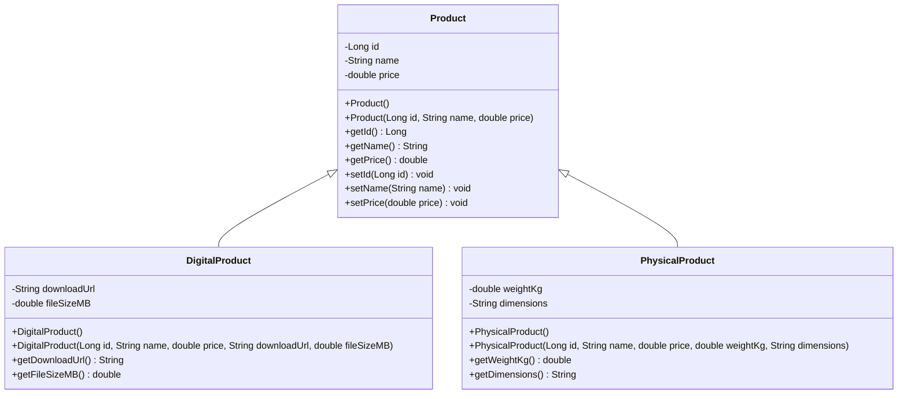

# Product Hierarchy  UML Class Diagram

5COSC019W Tutorial 4, Activity 4. Inheritance: a DigitalProduct IS-A Product, and a PhysicalProduct IS-A Product.
PlantUML version of the same diagram: [product-hierarchy.puml](product-hierarchy.puml).

Checks (Task 16):
- (a) the hollow triangle touches `Product`, not the children
- (b) neither child box repeats `id`, `name` or `price`; they are inherited
- (c) fields are marked `-` (private) and methods are marked `+` (public)
